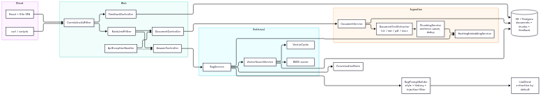
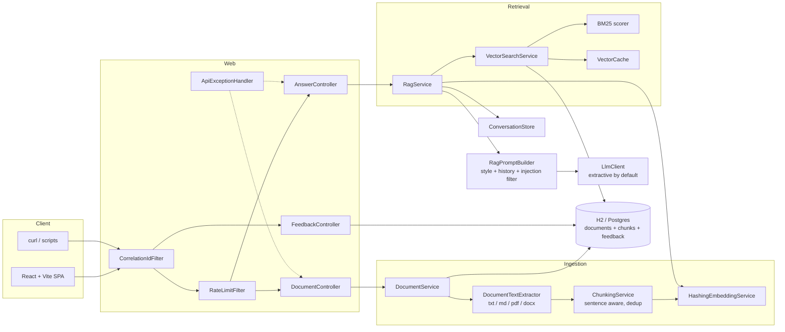

# Architecture

A single Spring Boot application serves both the REST API and the built React
bundle. Everything below runs inside one process; the only external dependency is
a database, and even that can be the in-memory H2 profile.

## Ingestion

`POST /api/documents` and `/api/documents/upload` hand text to `DocumentService`.
Uploads are first reduced to text by `DocumentTextExtractor`, so the pipeline
never sees PDF or DOCX internals. The service rejects duplicates and oversized
documents, splits the text into overlapping chunks, drops repeated boilerplate,
embeds each chunk and stores the vectors as JSON arrays next to the chunk text.

The raw document text is kept: reindexing (`POST /api/documents/reindex`) rebuilds
every chunk from it, which is what a change of embedding model requires. On
Postgres, re-inserted chunks get their pgvector column filled by the same trigger,
so both representations stay in step without ingestion knowing about either.

## Answering

`POST /api/ask` embeds the question with the same model used for the chunks and
asks the active `ChunkSearch` implementation for candidates. Retrieval gates on
cosine similarity and ranks by a blend with Okapi BM25, so rare terms are not
drowned out by common ones. An optional `documentId` narrows the query rather
than filtering afterwards.

Two implementations sit behind that seam. On H2, `VectorSearchService` scans
every chunk in memory and caches decoded vectors, which is simple and portable
but grows with the corpus. On the `postgres` profile, `PgVectorSearchService`
lets the HNSW index choose the nearest candidates and re-ranks that pool with
BM25; `PgVectorBootstrap` installs the extension, mirrors the JSON embedding into
a `vector(256)` column through a trigger and builds the index at startup. On
4,000 chunks a recorded difference was 312–430 ms versus 3.5–7.3 ms per
question, depending on the run.

Retrieved chunks are rendered into a prompt with numbered passages, the requested
length and tone, and the last few turns of the conversation. Instruction-like lines
inside documents are removed first. The default `LlmClient` is an extractive model
that quotes retrieved sentences with citation markers, which keeps the project
runnable without API keys; the interface is the seam for a hosted model.

`POST /api/ask/stream` runs the same path and emits SSE events instead of one
JSON body.

## Cross-cutting

- `CorrelationIdFilter` assigns or reuses `X-Request-Id`, puts it in the logging
  context and in error bodies.
- `RateLimitFilter` caps questions per client address per minute.
- `ApiExceptionHandler` maps domain exceptions onto one JSON error shape.
- Micrometer timers (`rag.retrieval`, `rag.generation`) and the `rag.answers`
  counter are exposed under `/actuator/metrics`.
